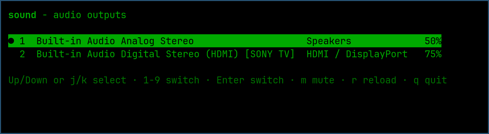

# sound

Terminal UI for switching the default **audio output** on PipeWire and PulseAudio — speakers, HDMI monitor, Bluetooth, USB — with a keypress.

[](https://pipewire.org/)
[](https://www.gnu.org/software/bash/)
[](https://opensource.org/license/MIT)
[](https://github.com/Icenux/sound)



## What it does

- **Lists every output** the sound server knows about, with its port, volume and state (muted, unplugged)
- **Switches in one key** — `Enter` on the selected output, or `1`–`9` to jump straight to output N
- **Moves playing streams** to the new output, so running apps follow instead of staying on the old one
- **Unmutes the new output**, so "switched" never means silence
- **Always detects the current outputs** — the list is re-read on start, on every keypress and every 2 s, so a monitor or Bluetooth speaker you connect while it is open simply shows up
- **Scriptable** — `sound next` and `sound set …` work without the UI, handy for a keybinding or a status bar click

Nothing is changed until you press a key — starting the program just shows the current state.

## Requirements

| What | Notes |
|------|-------|
| a sound server | PipeWire (with `pipewire-pulse`) or PulseAudio |
| `pactl` ≥ 16 | needs the JSON output; part of `pulseaudio-utils` (Debian/Ubuntu) or `libpulse` (Arch, Fedora: `pulseaudio-utils`) |
| `jq` | |
| bash ≥ 4.0 | not the macOS default 3.2 |
| `tput` | from ncurses, present on practically every system |

It talks only to the sound server, so it does not depend on the desktop environment or compositor: it runs the same on Sway, Hyprland, GNOME, KDE, X11 or Wayland. Debian 12, Ubuntu 24.04 and anything newer ship a recent enough `pactl`; Ubuntu 22.04 and Debian 11 do not.

## Installation

From the Icenux package repository (Debian / Ubuntu / Mint) — later versions then arrive with `apt upgrade`:

```bash
sudo curl -fsSL https://icenux.github.io/icenux/icenux.asc -o /usr/share/keyrings/icenux.asc
echo 'deb [signed-by=/usr/share/keyrings/icenux.asc] https://icenux.github.io/icenux/apt ./' \
  | sudo tee /etc/apt/sources.list.d/icenux.list
sudo apt update && sudo apt install sound
```

On Arch Linux, from the signed Icenux pacman repository (instructions on the [Icenux repository page](https://github.com/Icenux/icenux#how-to-use-it)), then `sudo pacman -Sy sound`. Or install the package from the [latest release](https://github.com/Icenux/sound/releases/latest):

```bash
sudo pacman -U sound-X.Y.Z-1-any.pkg.tar.zst
```

Or just the script:

```bash
cp sound ~/.local/bin/
chmod +x ~/.local/bin/sound
```

(assumes `~/.local/bin` is on `$PATH`)

## Usage

```bash
sound
```

| Key | Action |
|-----|--------|
| `↑` `↓` / `j` `k` | Select an output |
| `Enter` | Switch to the selected output |
| `1`–`9` | Switch to output N immediately |
| `m` | Mute / unmute the selected output |
| `r` | Reload the list of outputs |
| `q` / `Esc` | Quit |

Without the UI:

```bash
sound list                 # list outputs, "*" marks the default
sound next                 # switch to the next output (wraps around)
sound set hdmi             # by number, sink name or part of the description
sound --version
```

`sound next` makes a good keybinding, for example in Sway: `bindsym $mod+F10 exec sound next`.

## Why not just use `pactl` or `pavucontrol`?

`pactl set-default-sink` needs the exact sink name and leaves already playing streams where they are; `pavucontrol` is a full mixer window for a one-key job. `sound` lists what is actually connected right now, switches the default, moves the streams and unmutes — and stays out of the way in a terminal.

## Development

The whole program is one Bash script, `sound`. CI (`.github/workflows/ci.yml`) runs on every pull request:

```bash
bash -n sound packaging/package.sh packaging/files/postinst.sh   # syntax
shellcheck sound packaging/package.sh packaging/files/postinst.sh
./sound --version
bash packaging/package.sh "$(sed -n 's/^VERSION="\(.*\)"/\1/p' sound)"   # needs nfpm; builds the .deb and the Arch package
```

## Contributors

- [Luquas95](https://github.com/Luquas95) — creator & maintainer
